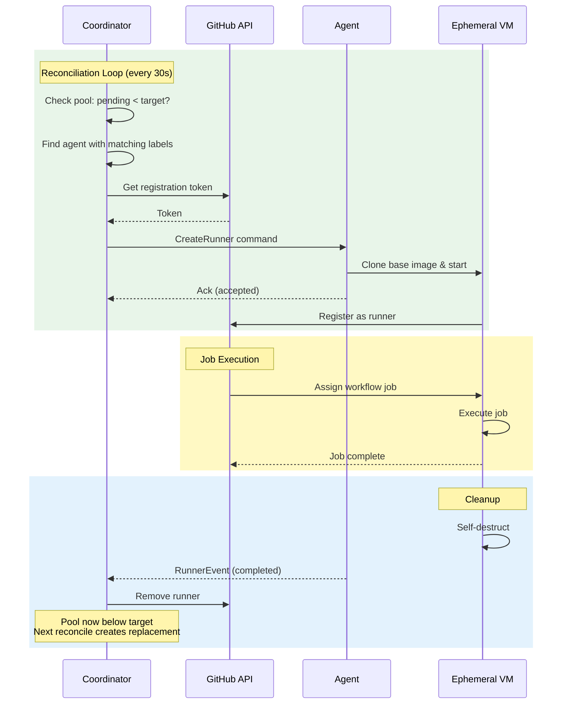
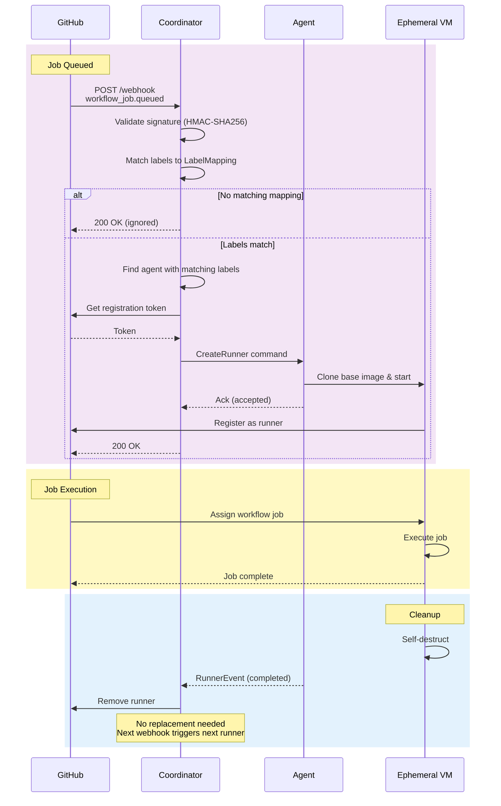
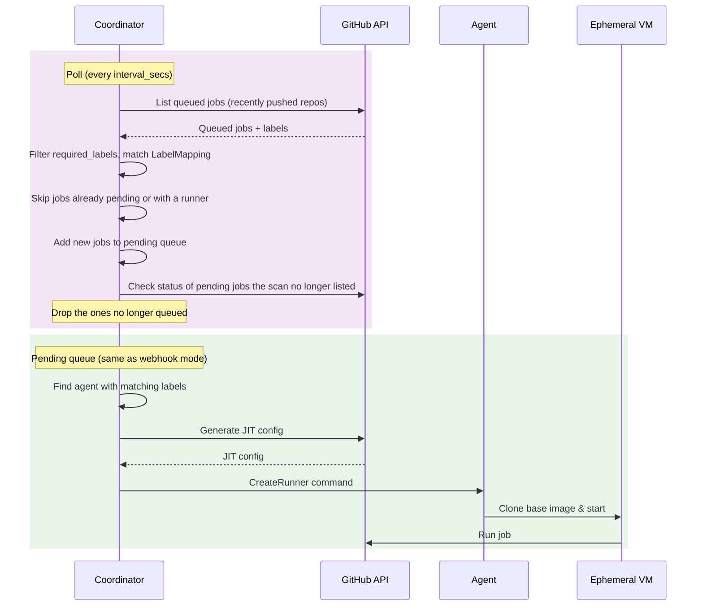

# Provisioning Flow

Sequence diagrams showing how runners are created in each provisioning mode.

## Fixed Capacity Mode

Maintains a constant pool of runners. The coordinator reconciles every 30 seconds.

## Webhook Mode (Dynamic)

Runners created on-demand when GitHub sends `workflow_job.queued` events.

## Polling Mode (Dynamic)

Runners created on-demand for queued jobs found by scanning the GitHub API every
`interval_secs` (default 120). Same pending queue and runner flow as webhook mode, but
nothing has to reach the coordinator from outside.

Each scan lists workflow runs per recently pushed repo, so short intervals across many
repos can exhaust the GitHub App's API rate limit; the coordinator warns below 60s.

## Comparison

| Aspect | Fixed Capacity | Webhook | Polling |
|--------|---------------|---------|---------|
| **Trigger** | 30s reconciliation loop | GitHub webhook event | API scan every `interval_secs` |
| **Pre-provisioning** | Yes - maintains pool | No - just-in-time | No - just-in-time |
| **Job latency** | Low (runners ready) | Higher (VM boot time) | Higher (scan interval + VM boot) |
| **Resource usage** | Constant | On-demand | On-demand |
| **Inbound access** | Not needed | Webhook endpoint | Not needed |
| **Configuration** | `[[runners]]` with `count` | `[[label_mappings]]` | `[[label_mappings]]` |
